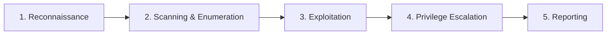

# The Hacker Methodology



A high-level exploration of the standardized penetration testing workflow: Reconnaissance, Enumeration & Scanning, Exploitation, Privilege Escalation, and Reporting.

---

## 1. The Five Stages of Penetration Testing

---

## 2. Methodology Breakdown

### Stage 1: Reconnaissance
Gathering open-source intelligence (OSINT) passively before interacting with target systems:
- OSINT tools like `sublist3r` enumerate target **subdomains**.
- Targeted search engine filtering is known as **Google Dorking**.

### Stage 2: Enumeration & Scanning
Directly probing ports and banners to discover active services, defining the target's total **attack surface**:
- Major ecosystem tools: **Metasploit** (developed by Rapid7) and **Burp Suite** (developed by PortSwigger).

### Stage 3: Exploitation
Delivering payloads to exploit discovered vulnerabilities.

### Stage 4: Privilege Escalation
Transitioning from initial low-privilege footholds to elevated system authorities:
- On Windows, the ultimate objective alongside Administrator is **SYSTEM** (NT AUTHORITY\SYSTEM).
- On Linux, discovering exposed or unencrypted SSH **keys** (e.g. `id_rsa`) enables lateral movement and root access.

### Stage 5: Reporting
Penetration testers deliver a **full formal report** outlining finding titles, technical descriptions, severity ratings, and actionable **Remediation Recommendations**.

---

## 🏁 Questions & Answers

| Task | Question | Answer |
|---|---|---|
| **Task 1** | What is the first phase of the Hacker Methodology? | `Reconnaissance` |
| **Task 2** | Who is the CEO of SpaceX? | `Elon Musk` |
| **Task 2** | What does sublist3r list? | `subdomains` |
| **Task 2** | Using Google to look for specific vulnerabilities | `Google Dorking` |
| **Task 3** | What does enumeration help determine about the target? | `attack surface` |
| **Task 3** | Company that developed Metasploit | `Rapid7` |
| **Task 3** | Company that developed Burp Suite | `PortSwigger` |
| **Task 4** | Primary exploitation tool pentesters use | `metasploit` |
| **Task 5** | Target account on Windows besides Administrator | `system` |
| **Task 5** | SSH artifact allowing login without password | `keys` |
| **Task 7** | Full documentation of all findings within a formal document | `full formal report` |
| **Task 7** | Critical item in report beyond name, description, and criticality | `Remediation Recommendation` |
